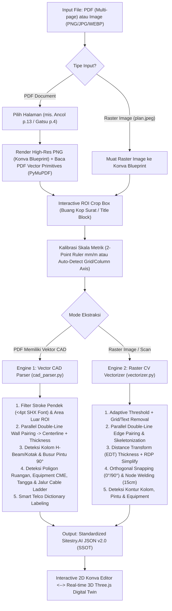

# Product Requirements Document (PRD) — Sitestry.AI (v2.0)

**Dokumen Spesifikasi Produk & Arsitektur Teknis**  
**Nama Produk:** **Sitestry.AI** (*AI-Powered 2D Technical Floorplan to 3D Data Center & Telco CME Digital Twin Studio*)  
**Versi:** 2.0 (Updated post-Discovery & Real APD Audit: Indosat Ancol Hal. 13 & Gatsu Barat Hal. 4)  
**Status:** Approved for End-to-End Prototype Execution

---

## 1. Executive Summary

### 1.1 Problem Statement
Tim *Engineering*, *CME (Civil, Mechanical, Electrical)*, dan *Data Center / Telco Site Deployment* membutuhkan waktu berjam-jam hingga berhari-hari untuk menerjemahkan dokumen gambar kerja 2D **APD (*As-Planned Drawing*)** berformat PDF/CAD atau gambar raster (`.jpeg`/`.png`) menjadi model 3D spasial guna memvalidasi penempatan perangkat (*Rack, UPS, Battery Bank, Rectifier, Panel ACPDB/SDP, PAC/AHU*), jalur *cable ladder/tray*, serta kapasitas lantai *raised floor*. Alat konversi denah rumah tangga yang ada di pasaran gagal memproses gambar teknik telekomunikasi karena:
1. Dinding CAD digambar sebagai **garis ganda berongga (*double-line hollow walls*)**, bukan blok hitam tebal.
2. Halaman gambar penuh dengan *noise* non-dinding seperti **Kop Surat (*Title Block*)**, garis dimensi (`6000`, `28000`), balon as grid (`A–F`, `1–3`), arsir tangga kabel (*cable ladder*), foto dokumentasi yang ditempel di dalam PDF, serta teks berformat *stroke* vektor AutoCAD (`SHX font`).
3. Kebutuhan visualisasi bukan sekadar dinding kosong, melainkan mencakup **kolom struktural H-Beam**, **partisi kawat (*wiremesh cage*)**, **elevasi lantai *raised floor* 60x60cm**, **perangkat CME/MEP**, dan **jalur *cable tray/ladder*** dengan akurasi metrik.

### 1.2 Proposed Solution
**Sitestry.AI** adalah aplikasi *web studio* berbasis **Human-in-the-Loop (HITL)** bergaya Homistry AI yang menggabungkan **Dual-Engine AI/CAD Extractor** (*Direct PDF Vector CAD Parser* + *OpenCV Double-Line Raster Vectorizer* + *Smart Telco Dictionary Matcher*) dengan **Interactive 2D Konva.js CAD Editor** dan **Real-Time 3D Three.js WebGL Digital Twin**. Seluruh tampilan 2D dan 3D disinkronkan secara *real-time* melalui satu objek **Single Source of Truth (SSOT) JSON** tanpa memerlukan *build step* di sisi *frontend*.

### 1.3 Success Criteria (KPIs)
1. **Akurasi Kalibrasi Metrik ($\le 1\%$ deviasi):** Ketika dikalibrasi pada jarak antar-kolom `6000 mm` (6.0m) di denah Gatsu Hal. 4 atau ubin *raised floor* `600 mm` (0.6m) di denah Ancol Hal. 13, geometri 3D yang terbangun memiliki rasio metrik yang presisi terhadap grid lantai 60x60cm.
2. **Isolasi ROI & Ketepatan Ekstraksi Struktur ($\ge 85\%$):** Dengan fitur *Interactive ROI Crop Box* dan *Dual-Engine Extractor*, Kop Surat (*Title Block*) tereliminasi 100%, serta minimal 85% dinding utama, kolom H-Beam/beton, pintu, ruangan, dan perangkat utama terdeteksi dan terkunci lurus ($0^\circ / 90^\circ$).
3. **Kecepatan Koreksi HITL ($< 60$ detik):** Engineer dapat mengoreksi segmen dinding, membagi dinding menjadi *Wiremesh Cage* / *Glass*, menambah perangkat CME (*UPS/Battery/Rack/PAC/Panel*), menggambar jalur *Cable Ladder*, atau mengubah nama ruangan dalam waktu di bawah 60 detik.
4. **Sinkronisasi 2D-ke-3D Instan ($< 100\text{ ms}$ / 60 FPS):** Perubahan posisi *vertex/node*, ketebalan dinding, elevasi *cable tray*, maupun dimensi perangkat di kanvas 2D atau *Property Inspector* langsung memperbarui model 3D di *Split View* dalam waktu kurang dari 100 milidetik.

---

## 2. User Experience & Functionality

### 2.1 User Personas
1. **Telco CME / MEP Planning Engineer:** Mengunggah PDF APD multi-halaman (seperti *WP1 APD Ancol* 28 halaman atau *Gatsu Barat* 11 halaman), memilih halaman denah lantai, mengkalibrasi skala, memvalidasi ruang *Battery / Rectifier / UPS / AHU / MDF*, serta memverifikasi jalur *cable ladder* dari panel ke perangkat.
2. **Data Center Capacity & Layout Architect:** Memodelkan struktur ruangan *white space* dengan lantai *raised floor* 60x60cm, partisi *wiremesh server cage*, kaca NOC, bukaan *double door* / *ramp*, dan susunan *Server Rack 42U* beserta *PAC*.
3. **Technical Project Manager / Reviewer:** Melakukan inspeksi visual 3D interaktif (*Orbit / First-Person Walkthrough* / *Top Ortho*) dan mengekspor model `.glb` atau skema `.json` tervalidasi untuk presentasi maupun integrasi lanjutan.

### 2.2 User Stories & Acceptance Criteria

| ID | User Story | Acceptance Criteria (Definition of Done) |
| :--- | :--- | :--- |
| **US-01** | **Sebagai Engineer**, saya ingin memilih halaman tertentu saat mengunggah PDF multi-halaman atau memuat *Preset Sample* (`Ancol Hal. 13`, `Gatsu Hal. 4`, `plan.jpeg`) dengan 1 klik. | - Tersedia **PDF Page Selector Modal** dengan *thumbnail preview* atau pemilih nomor halaman.<br>- Tersedia tombol **Quick Sample Loader** di *Top Ribbon* untuk langsung memuat **Ancol (Hal. 13)**, **Gatsu (Hal. 4)**, dan **Gatsu (`plan.jpeg`)** dari folder `floorplan/`. |
| **US-02** | **Sebagai Engineer**, saya ingin membatasi area ekstraksi (*Crop / ROI Box*) agar tabel Kop Surat (*Title Block*) dan bingkai luar tidak ikut terdeteksi sebagai dinding. | - Tersedia alat **ROI Crop Box** (`[C]`) di kanvas 2D dengan 4 titik sudut yang bisa digeser.<br>- Secara *default*, sistem otomatis menaruh ROI Box di area gambar utama (mengecualikan ~22% area Kop Surat di sisi kanan halaman APD). |
| **US-03** | **Sebagai Engineer**, saya ingin mengkalibrasi skala piksel-ke-meter menggunakan penggaris 2 titik (`mm` atau `m`) atau deteksi grid otomatis. | - Alat **2-Point Ruler** (`[R]`) menampilkan garis ukur interaktif dan *input popover* yang mendukung satuan `m` maupun `mm` (misal ketik `6000 mm` atau `6.0 m`).<br>- Tombol **Auto-Detect Scale** mengekstrak skala otomatis dari grid vektor PDF atau periodisitas piksel ubin 60cm. |
| **US-04** | **Sebagai Engineer**, saya ingin mengekstrak dinding, kolom, pintu, ruangan, peralatan CME, dan jalur kabel secara otomatis dari PDF maupun gambar raster. | - Untuk input PDF CAD, sistem membaca primitif vektor (`PyMuPDF`) ditambah penggabungan dinding garis ganda (*Double-Line Pairing*), deteksi kolom H-Beam hijau/kotak, deteksi busur pintu $90^\circ$, serta pencocokan kamus ruangan/perangkat Telco.<br>- Untuk input raster (`.jpeg`/`.png`), sistem menjalankan *OpenCV Double-Line & Morphological Skeletonizer*. |
| **US-05** | **Sebagai Engineer**, saya ingin mengedit hasil ekstraksi di kanvas 2D dan melihat hasilnya langsung di 3D (*Split View*). | - Mendukung alat: `Select/Move [V]`, `Draw Wall [W]`, `Split Wall [Double-Click]`, `Place Column [P]`, `Place Door/Ramp [D]`, `Draw Room Zone [Z]`, `Place CME Equipment [E]`, `Draw Cable Tray [T]`, `Place Stairs [S]`, `ROI Crop [C]`, `2-Point Ruler [R]`, `Delete [Del]`, dan `Undo/Redo [Ctrl+Z/Y]`. |
| **US-06** | **Sebagai Reviewer**, saya ingin melihat representasi 3D yang kaya dan realistis untuk elemen Data Center / Telco CME serta mengekspornya ke `.glb` dan `.json`. | - Lantai *raised floor* menampilkan grid 60x60cm prosedural dan mendukung beda elevasi (*plenum height*).<br>- Perangkat CME (`Rack 42U`, `UPS`, `Battery Bank`, `Rectifier`, `Panel ACPDB/SDP`, `PAC`) memiliki geometri 3D khas per kategori.<br>- *Cable Tray / Ladder* tampil sebagai tangga kabel 3D berjeruji dengan elevasi yang dapat diatur (*overhead* ~2.6m atau *underfloor* ~0.15m).<br>- Nama ruangan tampil sebagai *3D Floating Label* yang dapat di-*toggle*. |

### 2.3 Non-Goals (Batasan Lingkup v2.0)
1. **Simulasi CFD Termal & Aliran Udara Real-time:** Visualisasi 3D menampilkan unit PAC/AHU dan arah hadapnya, namun perhitungan simulasi fluida dinamika panas (CFD) berada di luar cakupan prototipe ini.
2. **Perhitungan Single-Line Diagram (SLD) Kelistrikan Otomatis:** Jalur *Cable Tray/Ladder* dan *Panel* divisualisasikan secara spasial 3D beserta panjang metriknya, namun tidak melakukan kalkulasi jatuh tegangan (*voltage drop*) atau *load balancing* otomatis.
3. **Pelatihan Model Deep Learning Berat di Browser/Lokal:** Sistem dirancang berjalan cepat di CPU standar tanpa mewajibkan GPU NVIDIA atau unduhan bobot model beberapa gigabyte.

---

## 3. Hasil Audit Dokumen APD Asli & Arsitektur AI / CAD Engine

Berdasarkan inspeksi langsung terhadap sampel di folder `floorplan/`:
* **`WP1 - APD - ANCOL, JAKARTA (12JKU0508)_R04_22-09-2026_Full signed.pdf` (Halaman 13):**
  * Merupakan gambar **Layout Gedung A, B, C Lt. 2 (Route Cable ke R. Nava Power Cable Existing)**.
  * Memiliki **36.437 grup vektor (54.362 primitif)** di mana garis grid *raised floor* 60x60cm tersimpan pada warna vektor abu-abu `RGB(0.502, 0.502, 0.502)` (7.046 grup), dinding dan rak pada `RGB(0, 0, 0)`, serta terdapat 13 citra JPEG dokumentasi yang ditempel di atas halaman.
  * Ruangan utama meliputi: *BATTERY ROOM (FFL +4.500)*, *RECTIFIER & PANEL ROOM (FFL +4.500)*, *JS ROOM*, *GUDANG*, *RUANG PERANGKAT / NEW RACK*, *SEAMEWE ROOM (FFL +4.850 RAISE FLOOR)*, *WIC NA-3 ROOM (FFL +4.650 RAISE FLOOR)*, *MARCONI ROOM*, *R. STAFF OPERASI & MAINTENANCE*, *GUDANG SPARE PART*, *TOILET*, dan *CORRIDOR*.
* **`WP-1-APD-IOH- GATSUBARAT-BALI-17DPS0040-MEP-R1-16.09-26_Full Signed.pdf` (Halaman 4) & `plan.jpeg`:**
  * Merupakan gambar **MSC GATSU LANTAI 1 — Layout 1st Floor Route Cable Power Proposed**.
  * Memiliki **8.957 grup vektor (24.696 primitif)** dengan pemisahan warna layer CAD yang sangat bersih:
    * **Hijau `RGB(0, 1, 0)`:** 18 Kolom Struktural H-Beam pada perpotongan Grid `A–F` ($\Delta X = 6000, 6000, 4000, 6000, 6000\text{ mm} = 28000\text{ mm}$) dan Grid `1–3` ($\Delta Y = 6000, 6000\text{ mm} = 12000\text{ mm}$), dengan skala eksak **$15.338\text{ pt/meter}$** pada PDF asli.
    * **Biru `RGB(0, 0.361, 0.722)`:** 22 simbol bukaan pintu (busur lingkaran 12-segmen berdiameter $0.8\text{ m}$ untuk pintu tunggal dan $1.6\text{ m}$ untuk pintu ganda).
    * **Hitam `RGB(0, 0, 0)`:** Dinding perimeter/partisi garis ganda (*double-line walls*), tangga gedung di sisi kiri & kanan, ruang *Capacitor Room* di kanan bawah, perangkat *Battery Lithium, UPS 250kVA, Panel A I/O, Panel SDP, LVMDP*, serta jalur *Cable Ladder* menuju *MDF Room* dan *Capacitor Room*.

### 3.1 Dual-Engine Extraction Pipeline (`backend/cad_parser.py` & `backend/vectorizer.py`)



### 3.2 Evaluation Strategy (Pengukuran Kualitas AI & Vektorisasi)
1. **Topological Wall Precision:** Persentase segmen dinding di dalam ROI yang terhubung pada *node* sudut tanpa celah (*watertight L/T/X-junctions*) setelah *Node Welding* ($15\text{ cm}$).
2. **Dimensional Fidelity:** Selisih panjang dinding atau jarak antar-kolom di 3D terhadap angka dimensi tertulis di gambar (`6000 mm`, `4000 mm`, `28000 mm`) harus berada di bawah $\pm 1.5\%$.
3. **Semantic Classification Recall:** Ketepatan identifikasi kolom struktural, bukaan pintu, serta pengenalan label ruangan utama Telco (*Battery Room, AHU Room, MDF Room, Gudang, R. Meeting, Rectifier, Capacitor Room*).

---

## 4. Technical Specifications

### 4.1 Arsitektur Tech Stack (100% Open-Source, Zero-Build Frontend)

| Lapisan | Teknologi / Pustaka | Lisensi | Peran dalam Sitestry.AI |
| :--- | :--- | :--- | :--- |
| **Frontend Core** | HTML5, CSS3, Vanilla JS (ES6 Modules) | Web Standard | Struktur aplikasi, manajemen *state* reaktif (`EventTarget` SSOT Store) dengan *Undo/Redo*, tanpa memerlukan Node.js/Vite. |
| **2D CAD Engine** | **Konva.js** (`v9.x` via CDN) | MIT | Kanvas *multi-layer* (Blueprint, ROI Box, Grid, Rooms, Cable Trays, Equipment, Walls/Nodes, Columns, Doors, Ruler) dengan *Magnetic Ortho-Snap*. |
| **3D WebGL Engine** | **Three.js** (`v0.160+`) + `OrbitControls` + `GLTFExporter` + `three-bvh-csg` | MIT | Render 3D *real-time*, *procedural 60x60cm raised floor shader*, ekstrusi dinding dengan *door cutout*, mesh perangkat CME detail, tangga kabel 3D, dan label ruangan 3D. |
| **Backend Server** | **Python 3.10+** + **FastAPI** + **Uvicorn** | MIT | Penyedia REST API ekstraksi geometri, pemrosesan PDF multi-halaman, dan penyaji berkas statis *frontend*. |
| **CAD & CV Engine** | **PyMuPDF (`fitz`)**, **OpenCV**, **scikit-image**, **SciPy**, **Shapely**, **NetworkX** | BSD / Apache | Ekstraksi primitif vektor PDF, *double-line wall pairing*, *skeletonization*, *Ramer-Douglas-Peucker*, dan topologi graf *node-edge*. |

### 4.2 Desain Antarmuka & Tata Letak (UI/UX Blueprint)

```text
+------------------------------------------------------------------------------------------------------------------+
| [Logo] Sitestry.AI  | Presets: [Ancol Hal.13] [Gatsu Hal.4] [plan.jpeg] | (1) Upload & Scale -> (2) 2D CAD Review -> (3) 3D Twin | [Export JSON/GLB] |
+---------------------+--------------------------------------------------------------------------------------------+
| CAD TOOLS (Kiri)    |                                                                             | INSPECTOR    |
| [V] Select / Move   |                         MAIN WORKSPACE AREA                                 | (Kanan)      |
| [C] ROI Crop Box    |                                                                             |              |
| [R] 2-Point Ruler   |   View Mode Switcher: [ 2D Blueprint ]  [ Split 2D | 3D ]  [ 3D Digital Twin ]             | Selected:    |
| ------------------- |                                                                             | Wall #w_04   |
| STRUCTURE TOOLS     |   +-----------------------------------+---------------------------------+   | Type:        |
| [W] Draw Wall       |   | 2D KONVA.JS INTERACTIVE CANVAS    | 3D THREE.JS WEBGL VIEWPORT      |   | [Wiremesh v] |
| [P] Place Column    |   | - High-Res APD Blueprint          | - 60x60cm Raised Floor Shader   |   | Height: 3.6m |
| [D] Place Door/Ramp |   | - ROI Crop Frame (Exclude Kop)    | - Walls, Cages, Glass & Doors   |   | Thick: 0.08m |
| [Z] Draw Room Zone  |   | - Topological Nodes & Walls       | - Green/Steel H-Beam Columns    |   |              |
| [S] Place Stairs    |   | - H-Beam Columns & Door Arcs      | - 42U Racks, UPS, Battery, PAC  |   | ------------ |
| ------------------- |   | - Equipment & Cable Ladder Paths  | - Overhead/Floor Cable Ladders  |   | QUICK ADD    |
| CME / MEP TOOLS     |   | - Magnetic 0°/90° Ortho-Snap      | - Floating 3D Room Nameplates   |   | Equipment /  |
| [E] Place Equipment |   +-----------------------------------+---------------------------------+   | Room Props / |
| [T] Draw Cable Tray |   | Telemetry: Scale: 63.9 px/m | ROI: Active | Snap: 90° | Elements: 84 |   | Elevation    |
| ------------------- |   +---------------------------------------------------------------------+   |              |
| LAYER TOGGLES       |                                                                             |              |
| [x] Blueprint (65%) |                                                                             |              |
| [x] Walls & Cages   |                                                                             |              |
| [x] Columns & Doors |                                                                             |              |
| [x] Rooms & Labels  |                                                                             |              |
| [x] CME Equipment   |                                                                             |              |
| [x] Cable Ladders   |                                                                             |              |
| [x] 60cm Floor Grid |                                                                             |              |
+---------------------+-----------------------------------------------------------------------------+--------------+
```

### 4.3 Kontrak Data: Standardized JSON Schema v2.0 (Single Source of Truth)

Seluruh komunikasi antara *Backend Extractor*, *2D Konva Editor*, dan *3D Three.js Builder* mematuhi struktur JSON tunggal berikut:

```json
{
  "project_id": "sitestry_gatsu_p4",
  "project_name": "MSC Gatsu Lantai 1 - CME Uplift WP1 UPS System",
  "metadata": {
    "source_type": "pdf_vector",
    "source_filename": "WP-1-APD-IOH- GATSUBARAT-BALI-17DPS0040-MEP-R1-16.09.26_Full Signed.pdf",
    "page_number": 4,
    "image_width_px": 1650,
    "image_height_px": 1275,
    "scale_px_per_meter": 31.95,
    "default_wall_height_m": 3.6,
    "raised_floor_grid_m": 0.6,
    "roi_px": { "x": 95, "y": 90, "width": 1215, "height": 960 }
  },
  "nodes": [
    { "id": "n1", "x_px": 215.0, "y_px": 369.0 },
    { "id": "n2", "x_px": 1110.0, "y_px": 369.0 }
  ],
  "walls": [
    {
      "id": "w1",
      "start_node": "n1",
      "end_node": "n2",
      "thickness_m": 0.20,
      "height_m": 3.6,
      "type": "solid",
      "label": "North Perimeter Wall"
    }
  ],
  "columns": [
    {
      "id": "col1",
      "x_px": 215.0,
      "y_px": 369.0,
      "width_m": 0.55,
      "depth_m": 0.55,
      "height_m": 3.6,
      "rotation_deg": 0,
      "type": "h_beam",
      "grid_label": "A-1"
    }
  ],
  "openings": [
    {
      "id": "op1",
      "wall_id": "w1",
      "offset_ratio": 0.45,
      "width_m": 1.6,
      "height_m": 2.2,
      "elevation_m": 0.0,
      "type": "double_door",
      "swing_dir": 1
    }
  ],
  "rooms": [
    {
      "id": "rm1",
      "name": "BATTERY & UPS ROOM",
      "polygon_px": [[725, 625], [925, 625], [925, 755], [725, 755]],
      "floor_type": "raised_floor_60cm",
      "elevation_m": 0.20,
      "color": "#0EA5E9"
    }
  ],
  "equipments": [
    {
      "id": "eq1",
      "name": "UPS FRAME 250kVA",
      "category": "ups",
      "x_px": 845.0,
      "y_px": 715.0,
      "width_m": 1.6,
      "depth_m": 0.9,
      "height_m": 2.0,
      "elevation_m": 0.20,
      "rotation_deg": 0
    }
  ],
  "cable_trays": [
    {
      "id": "ct1",
      "name": "Power Cable Ladder UPS to Panel SDP & Capacitor",
      "type": "ladder",
      "points_px": [[750, 725], [750, 645], [910, 645], [910, 745], [1320, 745]],
      "width_m": 0.40,
      "elevation_m": 2.65
    }
  ],
  "stairs": [
    {
      "id": "st1",
      "name": "Main West Staircase",
      "x_px": 285.0,
      "y_px": 465.0,
      "width_m": 3.2,
      "depth_m": 4.2,
      "height_m": 3.6,
      "rotation_deg": 0
    }
  ]
}
```

### 4.4 Endpoint API Backend (`backend/main.py`)
1. `GET /api/samples`: Mengembalikan daftar sampel bawaan di folder `floorplan/` (`ancol_p13`, `gatsu_p4`, `gatsu_jpeg`) beserta metadata halaman.
2. `POST /api/load-sample`: Memuat salah satu sampel bawaan, merender citra halaman beresolusi tinggi, dan mengembalikan informasi awal beserta rekomendasi ROI dan skala.
3. `POST /api/pdf-info`: Menerima unggahan berkas `.pdf` dan mengembalikan jumlah halaman beserta *thumbnail preview* agar user dapat memilih halaman yang diinginkan.
4. `POST /api/pdf-to-image`: Merender halaman PDF spesifik (`page_number`, *1-indexed*) menjadi PNG tajam (`150–200 DPI`) untuk kanvas 2D.
5. `POST /api/detect-grid`: Menerima gambar / halaman PDF dan ROI untuk mendeteksi skala metrik (`scale_px_per_meter`) secara otomatis menggunakan analisis jarak antar-kolom/grid vektor atau *Fast Fourier Transform (FFT)* / autokorelasi spasial pada ubin *raised floor* 60cm.
6. `POST /api/extract-layout`: Menjalankan **Dual-Engine Extractor** (`cad_parser.py` untuk PDF vektor atau `vectorizer.py` untuk gambar raster) di dalam batas `roi_px` menggunakan `scale_px_per_meter`, menghasilkan struktur JSON **Sitestry.AI v2.0** lengkap.

---

## 5. Risks & Roadmap

### 5.1 Technical Risks & Mitigations
| Risiko Teknis | Dampak | Strategi Mitigasi di Sitestry.AI |
| :--- | :--- | :--- |
| **Teks AutoCAD SHX di PDF terbaca sebagai ribuan garis kecil** | Tinggi (Merusak topologi dinding dan memperlambat *browser*) | Filter matematis di `cad_parser.py` mengeliminasi segmen pendek ($< 4.0\text{ pt}$) dari kandidat dinding dan mengelompokkannya khusus sebagai klaster label teks. |
| **Kop Surat (*Title Block*) dan tabel revisi terdeteksi sebagai labirin dinding** | Tinggi | Penerapan **Interactive ROI Crop Box** otomatis dan manual di kanvas 2D sebelum ekstraksi dijalankan. |
| **Dinding garis ganda (*double-line*) menjadi 2 dinding berdempetan** | Sedang–Tinggi | Algoritma **Parallel Double-Line Wall Pairing** mencari pasangan segmen sejajar berjarak $0.08\text{ m} - 0.35\text{ m}$ dan meleburnya menjadi 1 garis tengah (*centerline*) dengan atribut `thickness_m` akurat. |
| **Operasi Boolean CSG di 3D lambat jika ada puluhan pintu** | Sedang | Kombinasi `three-bvh-csg` dan *Analytical Wall Segment Splitting* (membagi dinding secara prosedural menjadi segmen kiri, ambang atas pintu *lintel*, dan segmen kanan + kusen 3D) yang berjalan dalam $< 2\text{ ms}$ untuk ratusan pintu. |

### 5.2 Phased Rollout Roadmap
* **Phase 1 — MVP Core (Current Release v2.0):**
  * Ingesti PDF multi-halaman (Page Selector) & Gambar Raster + 1-Click Sample Presets (`Ancol Hal. 13`, `Gatsu Hal. 4`, `plan.jpeg`).
  * Interactive ROI Crop Box & Kalibrasi Skala Metrik (2-Point Ruler `mm`/`m` + Auto-Detect Scale).
  * Dual-Engine Extractor (PDF Vector CAD Parser + OpenCV Double-Line Raster Vectorizer + Smart Telco Dictionary).
  * Full 2D Konva CAD Editor & Real-time 3D Three.js Digital Twin (Walls, Cages, Glass, H-Beam Columns, Doors/Ramps, Raised Floor 60cm + Plenum Elevation, CME Equipment Meshes, 3D Cable Ladders, Stairs, Floating Room Labels, JSON/GLB Export).
* **Phase 2 — v2.1 (Next Iteration):**
  * Kalkulasi otomatis kebutuhan panjang kabel (*Bill of Materials / BoQ*) dari titik perangkat ke panel sepanjang jalur *3D Cable Ladder*.
  * Pengecekan aturan *clearance* otomatis (jarak aman depan/belakang *Server Rack* & *Panel Listrik* sesuai standar Tier-III Data Center).
* **Phase 3 — v3.0 (Enterprise):**
  * Ekspor langsung ke format `.ifc` (BIM / Autodesk Revit) dan integrasi sensor IoT suhu/daya secara *live*.
