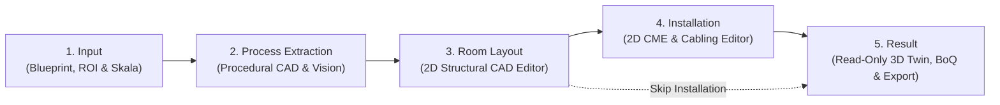

# Sitestry.AI — Application & Engineering Workflow (`WORKFLOW.md`)

This document defines both the **5-Stage Segmented User Workflow** inside the Sitestry.AI application and the **Engineering & Agent Handover Workflow** for contributors and coding agents.

---

## Part 1: 5-Stage Segmented Application Workflow

Sitestry.AI enforces a strict, uncluttered 5-stage architectural pipeline (`Input -> Process Extraction -> Room Layout -> Installation -> Result`). Each stage has its own dedicated sidebar panel (`#stagePanel1` .. `#stagePanel5`) and viewport mode controlled via `body[data-stage="1".."5"]`.

### UI shell (v4 Dock + Wizard, default)
- **Navigation**: one stage control, the bottom timeline (`Back`, five stage dots, `Next`). `Ctrl/Cmd+K` opens a command palette to jump stage, switch view, undo/redo, export, and toggle layers.
- **Stage 1-2 are wizard cards** floating over a full-bleed canvas; **Stage 3-5 are a dock workbench**: a 56 px icon rail, a flyout for secondary controls (wall assist, layers, stair parameters, CME catalog, Result view toggles), and a property panel that floats beside the selected object.
- **View Mode (`2D | Split | 3D`), Camera Presets, BoQ Panel, and `Export` Menu** appear **only in Stage 5 (`Result`)**, keeping Stages 1–4 uncluttered 2D workspaces.
- **Workspace (many projects)**: the app opens on a Workspace page. Empty: only an upload field (PDF, PNG, JPG). Otherwise a card grid, newest first: each card has thumbnail, title, saved time, counts, status chips (`Input` / `Ekstraksi` / `3-4 Editor` / `5 Result 3D`), `Buka` (restores that project's saved source, project and furthest stage; 3D is rebuilt automatically only when `built_hash === saved_hash`) and `Hapus` (asks first). Storage: `workspace/projects/<id>/` (source file, `project.json`, `meta.json`).
- **Auto-Save Toggle & Combined Build Snapshot**: `#chkAutoSave` (default **ON**, persisted in `localStorage`) debounces automatic saves (~1.2 s) for edits in both **Stage 3 (Room Layout)** and **Stage 4 (Installation)**, tracked via `projectHash` in `workspaceState.js`. Turning Auto-Save **OFF** reverts to manual save (`Simpan` / `Ctrl/Cmd+S`) with `beforeunload` and Stage 5 entry guards. Any edit to Room Layout or Installation after the last build marks the Result build `stale`, prompting **Build Ulang 3D** in Stage 5 (or auto-building when clicking `Build & Lihat Result`).
- Dev/test boot: `?sample=<id>` skips the home page, loads that sample and backs it with a workspace.
- `?ui=v3` switches to the legacy UI and remembers the choice; `?ui=v4` switches back. Below 1100 px the dock becomes the existing dismissible drawer (`Escape` closes it).

### Stage 1: Input (`data-stage="1"`)
- **v4**: Stage 1 offers only upload (no sample picker). After extraction (Stage 2 reached) ROI and scale become a read-only summary; `Ubah ROI/Skala dan ekstrak ulang` asks first and then discards the Stage 3 edits and the built 3D. Re-running extraction in Stage 2 asks the same.
- **Goal**: Load the 2D source floorplan, select the target PDF page (e.g., Page 4 for Gatsu, Page 13 for Ancol), isolate the floorplan geometry using the **Active ROI Crop Box (`[C]`)** to exclude the right-hand *Kop Surat* (Title Block), and calibrate `scale_px_per_meter` via **Auto-Calibrate Grid** or the **2-Point Metric Ruler (`[R]`)**.
- **Viewport State**: 2D Blueprint Canvas (`viewMode: "2d"`), structural overlays hidden so the user can clearly inspect the raw drawing and ROI boundaries.

### Stage 2: Process Extraction (`data-stage="2"`)
- **Goal**: Execute the deterministic 4-stage Procedural Vision & CAD Extraction engine (`POST /api/extract-layout`) and inspect the extracted structural topology overlaid on the original blueprint:
  1. **Wall & Small-Room Topology**: Extracts filled wall quads + parallel double-line walls (`1.3–5.5 px` spacing for small rooms, toilets, musholla, pantry, corridors, bridges), bridges wall gaps across doors/windows, and snaps L/T/X intersections (`TopologicalGraphBuilder`).
  2. **Door Leaf, Swing Arc & Door Tag Alignment**: Detects quarter-circle (`90°`) swing arcs and thin door leaves verified by nearby arc segments, pairing them into `single_door` (`D-xx`, `TD-xx`) or `double_door` (`DD-xx`) with exact **Door Tag** alignment.
  3. **Window Mullion & Glazing Detection**: Detects perimeter multi-line glazing symbols (`W-01..W-xx`).
  4. **Stair Step Cluster & Pillar Grid Recognition**: Detects periodic parallel stair treads ($\ge 5$ equidistant steps) and structural H-Beam / X-cross grid columns.
- **v4 flow**: `Next` from Stage 1 enters Stage 2 first, then extracts (legacy UI still extracts before entering). While the request runs the card shows an indeterminate bar, never a percentage or ETA; the result is then revealed step by step (walls + openings, columns, stairs/trays, rooms) with live counters. If the server cannot be reached, `api.extractLayout` returns a client-generated stand-in and the card states that plainly (`fallback`) with a retry button. Changing stage or re-running cancels a reveal in progress.
- **Note**: Equipment (`equipments: []`) and cable trays (`cable_trays: []`) are intentionally kept empty during structural extraction so the structural layout remains 100% clean.

### Stage 3: Room Layout (`data-stage="3"`)
- **Goal**: Sub-Editor 1 — Human-in-the-Loop (HITL) 2D Structural CAD verification and manual refinement (`nodes`, `walls`, `openings`, `columns`, `stairs`, `rooms`).
- **2D-Only Workspace**: `view-mode-group` is hidden. Cable trays, pipes, equipments, and cables are hidden so structural layout edits stay clean while existing Stage 4 Installation data is preserved in the background.
- **Skipping Installation**: Users may proceed to **Stage 4 (Installation)** or skip directly to **Stage 5 (Result)** (`Lewati ke Result`).
- **Capabilities**:
  - Drag **Topological Nodes (`[V]`)** at any zoom; one completed drag is one undo. Shared nodes move every connected wall, and numeric meter fields provide precision editing while canonical coordinates remain source pixels.
  - Drag **Doors & Windows** directly along their host wall segment to fine-tune `offset_ratio`.
  - Draw walls with a single drag (`[W]`). **Endpoint Snap (10 CSS px)** is on by default (toggle in the flyout) and a ring on the node or a dot on the wall shows what the wall will connect to while the cursor is near; **Ortho Assistance** is an optional toggle. Starting/ending on a node reuses it; ending on a wall interior splits that wall atomically and remaps hosted openings so their physical position, tag, and swing stay unchanged. Infeasible splits are rejected without partial changes.
  - **Guided wall mode** loads advisory wall-centerline candidates from the actual PDF vector page or raster bitmap (`POST /api/blueprint-guides`). Candidate highlighting is shown before commit. Loading, error, and no-match states keep manual preview available; guidance is never treated as existing annotation.
  - Attach `Single Door [D]`, `Double Door [B]`, `Window [N]`, `Pillar [P]`, parametric `Stair [S]`, and `Room Zone [Z]`.
  - **Room Zone `[Z]`** has two modes (flyout card `Zona Ruangan`). **Klik ruangan** (default): hover highlights the room closed by walls, one click creates a zone with the exact shape (L, T, diagonal walls included); walls that stop within 0.6 m of each other still close a room, walls crossing without a node are split automatically, dangling walls are ignored; clicking where a zone already exists selects it instead of adding another. If the area is not closed the tool says so and switches to **Poligon**: click vertices (they snap to wall nodes within 10 px), close by clicking the first point, `Enter`, or a double click on the last point; `Backspace` removes the last point and `Esc` cancels. Invalid polygons (fewer than 3 points, self-crossing, under 0.25 m²) are rejected with a message and the draft is kept. A new zone is named from the label OCR reads inside its shape (RapidOCR in the backend, once per source and page, noise such as elevations, areas and equipment tags filtered); when OCR is unavailable or finds nothing the name is `Ruangan N`. The card shows the OCR status. The name field is focused after creation. In Select mode a selected zone shows a handle per vertex; one drag is one undo and `Esc` cancels it. Zones do not follow later wall edits.
  - Parametric stairs support **Straight, L, and U** templates. Click the lower entrance, preview flights/treads/landing/route, then click the upper exit. L/U expose heading, turn, landing depth, and U flight run; invalid configurations keep an editable preview and a field-specific reason instead of moving endpoints. Legacy extracted stairs remain on the legacy path until an explicit, undoable conversion.
  - Edit **Door Tag** (`DD-01`, `D-02`, `TD-01`), **Swing Direction** (`in-left`, `in-right`, `out-left`, `out-right`), wall material (`solid`, `cage_mesh`, `glass`), and dimensions in the contextual Right Property Inspector.
  - Stage 3 is the 2D editor only: the `2D | Split | 3D` pill is hidden and the palette view actions start at Stage 4. Each rail tool shows its shortcut key.
  - **Tool isolation**: an active drawing tool (`[W]`, `[D]`, `[B]`, `[N]`, `[P]`, `[S]`, `[Z]`) ignores every other element, so nothing is selected or dragged by accident. Switching to such a tool clears the selection. `Esc` cancels a draft in progress; with nothing in progress it returns to Select (v4).
  - Deleting a wall or vertex also removes the vertices that no other wall uses. A red ring marks wall ends that stay open after ends within 0.3 m are bridged (layer `Ujung dinding menggantung`, Stage 3 only), so gaps are easy to find and fix.
  - The property inspector is docked at the top right, below the view controls (`2D Fit`, camera buttons), and does not follow the selection.
  - The inspector is hidden when nothing is selected, so the 2D canvas occupies at least 75% of the workspace at 1280 px and wider. Layer/opacity controls live in an on-demand disclosure; below 1100 px tools and properties become dismissible overlays.

### Stage 4: Installation (`data-stage="4"`)
- **Goal**: Sub-Editor 2 — 2D CME / MEP Installation (`equipment`, `cable_trays`, `pipe_runs`, `cables`) overlaid on the read-only, click-through Room Layout.
- **2D-Only Workspace**: `view-mode-group` remains hidden so drawing tools are unobstructed.
- **Edit rule**: only `equipment`, `tray`, `pipe`, and `cable` can be drawn, selected, dragged, deleted, or edited in Stage 4. Structural layers (`cadLayer`, `roomsLayer`, and stairs) are click-through.
- **Rotated Equipment Labels**: Rotating an equipment rotates only its footprint and front-face indicator (`#fbbf24`), while its name label remains horizontally fixed (`0°`) with a compact readable backdrop pill.
- **Auto-Cabling UX**: When `Cabling (C)` is active, existing cable lines disable pointer hit-testing (`listening: false`), all existing cables hide while connecting `Source -> Target`, and hovering an equipment renders a system-colored highlight ring + action badge (`Source:` / `Hubungkan ke ...` / `Batal Source:`) with snapped dashed preview.
- **Capabilities**:
  - **5 Generic Equipment Categories (Style A)**: Choose from **Rack**, **Power**, **Data**, **Cooling**, and **Security**, refine the subtype, and click to place (wall-mounted items snap automatically).
  - **Cable Tray (`[T]`)**: Pick tray construction (`perforated`, `ladder`, `duct`, `wiremesh`) and service category (`unified`, `power`, `data`); click route points (`Shift` = straight 90°), finish with `Enter`, double click, or right click.
  - **Cooling Pipe (`[P]`)**: Draw underfloor (`0.15 m`) or overhead cooling pipe runs.
  - **Auto-Cabling (`[C]`, Source -> Target)**: Choose system (`Power` Path A/B, `Grounding`, `Link`, `Cooling`, `Security`) and drop style (`Tray Waterfall` or `Direct Drop`), click Source then Target.
- **CTA**: `Build & Lihat Result` saves pending changes, snapshots the full project (Room Layout + Installation) into `builtProject`, and opens Stage 5 (`Result`).

### Stage 5: Result (`data-stage="5"`)
- **Goal**: Read-Only 3D Digital Twin, 2D/Split/3D inspection, live BoQ review, and `.JSON`/`.GLB` export.
- **Strictly Read-Only**: `store.canEdit(kind)` returns `false` for all kinds (`nodes`, `walls`, `openings`, `columns`, `stairs`, `rooms`, `equipments`, `tray`, `pipe`, `cable`). Both 2D and 3D allow selecting elements to inspect properties, panning/orbiting, toggling X-Ray walls or `Transparan Lantai`, and switching `view-mode-group` (`2D Blueprint & CAD` | `Split 2D | 3D Sync` | `3D Digital Twin`), with zero dragging, deleting, or editing.
- **Build Snapshot & Rebuild**: `Viewer3DEngine` renders `store.builtProject` (combined Room Layout + Installation). Any edit in Stage 3 or Stage 4 changes `projectHash` relative to `built_hash`, displaying the Build Banner (`Build Ulang 3D`) upon entering Stage 5 via timeline/stepper.
- **3D CSG & Architectural/CME Geometry**:
  - **Base floor**, boolean door/window CSG cutouts, swinging doors, mullioned windows, H-Beam columns, 60x60cm Raised Floor Plenums, parametric stairs, 3D equipment, typed Cable Trays + Fittings, hollow-bore Cooling Pipes, and Auto-Cabling + adaptive `Tray Waterfall` chutes.
  - Review collapsible live BoQ (`#boqPanel`) and export `.JSON` or `.GLB`.

---

## Part 2: Engineering & Agent Development Workflow

Every engineering task or feature phase must follow this sequence:

1. **Context & State Check**:
   - Read `AGENTS.md`, `CHANGELOG.md`, `todo.md`, and `GLOSSARY.md`. Do not re-read files already in context.
2. **Grill & Specification (`grill-me` / `grill-with-docs` / `Superpowers`)**:
   - Before writing code for underspecified or architectural changes, stress-test requirements with the user via `grill-me` rounds.
   - Save any generated specification or implementation plan to `docs/superpowers/specs/` or `docs/superpowers/plans/` (never duplicate plans, and **never commit** plans to Git).
3. **Phase Task Tracking (`todo.md`)**:
   - Ensure all tasks in the previous `todo.md` phase are completed (`[x]`), then **overwrite** `todo.md` with the new phase's actionable checklist.
4. **Atomic Implementation & Git Hygiene**:
   - Implement changes cleanly following `DESIGN.md` (for UI) and `GLOSSARY.md` (for domain models).
   - Update `.gitignore` whenever new untracked artifacts/files should be excluded.
   - Commit every functional change atomically **without any AI attribution** (repo owner only).
5. **Verification & Documentation Sync**:
   - Verify backend extraction (`cad_parser.py`, `vectorizer.py`, `main.py`) and frontend 2D/3D rendering (`store.js`, `canvas2d.js`, `viewer3d.js`, `app.js`).
   - Update `CHANGELOG.md`, `todo.md`, and core docs (`WORKFLOW.md`, `AGENTS.md`, `GLOSSARY.md`) whenever key features or workflows change.
