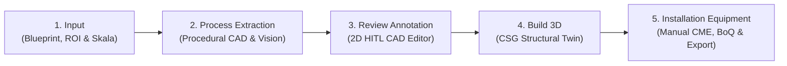

# Sitestry.AI — Application & Engineering Workflow (`WORKFLOW.md`)

This document defines both the **5-Stage Segmented User Workflow** inside the Sitestry.AI application and the **Engineering & Agent Handover Workflow** for contributors and coding agents.

---

## Part 1: 5-Stage Segmented Application Workflow

Sitestry.AI enforces a strict, uncluttered 5-stage architectural pipeline (`Input -> Process Extraction -> Review Annotation -> Build 3D -> Installation Equipment`). Each stage has its own dedicated sidebar panel (`#stagePanel1` .. `#stagePanel5`) and viewport mode controlled via `body[data-stage="1".."5"]`.

### UI shell (v4 Dock + Wizard, default)
- **Navigation**: one stage control, the bottom timeline (`Back`, five stage dots, `Next`). `Ctrl/Cmd+K` opens a command palette to jump stage, switch view, undo/redo, export, and toggle layers.
- **Stage 1-2 are wizard cards** floating over a full-bleed canvas; **Stage 3-5 are a dock workbench**: a 56 px icon rail, a flyout for secondary controls (wall assist, layers, stair parameters, CME catalog), and a property panel that floats beside the selected object.
- **Export** is one `Export` menu in Stage 4-5. The Stage 5 BoQ panel shows the structural summary plus a count per equipment category.
- **Workspace (many projects)**: the app opens on a Workspace page. Empty: only an upload field (PDF, PNG, JPG). Otherwise a card grid, newest first: each card has thumbnail, title, saved time, counts, status chips (Input / Ekstraksi / Review / 3D), `Buka` (restores that project's saved source, project and furthest stage; 3D is rebuilt automatically only when it matches the saved version) and `Hapus` (asks first). The project that is open in this session is marked and says `Kembali`. A last `Project baru` card uploads a new floorplan; every upload (home or Stage 1) creates a **new** project and never overwrites another. Opening another project while the current one has unsaved edits asks first. The header `Workspace` link returns to the list without discarding the live session. Storage: `workspace/projects/<id>/` (source file, `project.json`, `meta.json`); an old single-project `workspace/` is migrated into a project when the server starts.
- **Save and Build 3D are manual.** The header `Simpan` button (or `Ctrl/Cmd+S`) writes the project to the backend `workspace/` folder; there is no autosave and the page warns before closing with unsaved changes. Stage 4 cannot be entered while there are unsaved changes. Stage 4 shows the last built 3D with a banner (`Belum ada 3D` or `Denah berubah sejak build terakhir`) and a `Build 3D` button; a build always uses the saved version. Stage 5 equipment stays live on top of the built structure.
- Dev/test boot: `?sample=<id>` skips the home page, loads that sample and backs it with a workspace.
- `?ui=v3` switches to the legacy UI and remembers the choice; `?ui=v4` switches back. Below 1100 px the dock becomes the existing dismissible drawer (`Escape` closes it).

### Stage 1: Input (`data-stage="1"`)
- **v4**: Stage 1 offers only upload (no sample picker). After extraction (Stage 2 reached) ROI and scale become a read-only summary; `Ubah ROI/Skala dan ekstrak ulang` asks first and then discards the Stage 3 edits and the built 3D. Re-running extraction in Stage 2 asks the same.
- **Goal**: Load the 2D source floorplan, select the target PDF page (e.g., Page 4 for Gatsu, Page 13 for Ancol), isolate the floorplan geometry using the **Active ROI Crop Box (`[C]`)** to exclude the right-hand *Kop Surat* (Title Block), and calibrate `scale_px_per_meter` via **Auto-Calibrate Grid** or the **2-Point Metric Ruler (`[R]`)**.
- **Viewport State**: 2D Blueprint Canvas (`viewMode: "2d"`), structural overlays hidden so the user can clearly inspect the raw drawing and ROI boundaries.

### Stage 2: Process Extraction (`data-stage="2"`)
- **Goal**: Execute the deterministic 4-stage Procedural Vision & CAD Extraction engine (`POST /api/extract-layout`) and inspect the extracted structural topology overlaid on the original blueprint:
  1. **Wall & Small-Room Topology**: Extracts filled wall quads + parallel double-line walls (`1.3–5.5 px` spacing for small rooms, toilets, musholla, pantry, corridors, bridges), bridges wall gaps across doors/windows, and snaps L/T/X intersections (`TopologicalGraphBuilder`).
  2. **Door Leaf, Swing Arc & Door Tag Alignment**: Detects quarter-circle (`90°`) swing arcs and thin door leaves verified by nearby arc segments, pairing them into `single_door` (`D-xx`, `TD-xx`) or `double_door` (`DD-xx`) with exact **Door Tag** alignment.
  3. **Window Mullion & Glazing Detection**: Detects perimeter multi-line glazing symbols (`W-01..W-xx`).
  4. **Stair Step Cluster & Pillar Grid Recognition**: Detects periodic parallel stair treads ($\ge 5$ equidistant steps) and structural H-Beam / X-cross grid columns.
- **v4 flow**: `Next` from Stage 1 enters Stage 2 first, then extracts (legacy UI still extracts before entering). While the request runs the card shows an indeterminate bar, never a percentage or ETA; the result is then revealed step by step (walls + openings, columns, stairs/trays, rooms) with live counters. If the server cannot be reached, `api.extractLayout` returns a client-generated stand-in and the card states that plainly (`fallback`) with a retry button. Changing stage or re-running cancels a reveal in progress.
- **Note**: Equipment (`equipments: []`) and cable trays (`cable_trays: []`) are intentionally kept empty during structural extraction so the structural layout remains 100% clean.

### Stage 3: Review Annotation (`data-stage="3"`)
- **Goal**: Human-in-the-Loop (HITL) 2D CAD verification and manual refinement before 3D extrusion.
- **Capabilities**:
  - Drag **Topological Nodes (`[V]`)** at any zoom; one completed drag is one undo. Shared nodes move every connected wall, and numeric meter fields provide precision editing while canonical coordinates remain source pixels.
  - Drag **Doors & Windows** directly along their host wall segment to fine-tune `offset_ratio`.
  - Draw walls with a single drag (`[W]`). **Endpoint Snap (10 CSS px)** is on by default (toggle in the flyout) and a ring on the node or a dot on the wall shows what the wall will connect to while the cursor is near; **Ortho Assistance** is an optional toggle. Starting/ending on a node reuses it; ending on a wall interior splits that wall atomically and remaps hosted openings so their physical position, tag, and swing stay unchanged. Infeasible splits are rejected without partial changes.
  - **Guided wall mode** loads advisory wall-centerline candidates from the actual PDF vector page or raster bitmap (`POST /api/blueprint-guides`). Candidate highlighting is shown before commit. Loading, error, and no-match states keep manual preview available; guidance is never treated as existing annotation.
  - Attach `Single Door [D]`, `Double Door [B]`, `Window [N]`, `Pillar [P]`, parametric `Stair [S]`, and `Room Zone [Z]`.
  - **Room Zone `[Z]`** has two modes (flyout card `Zona Ruangan`). **Klik ruangan** (default): hover highlights the room closed by walls, one click creates a zone with the exact shape (L, T, diagonal walls included); walls that stop within 0.6 m of each other still close a room, walls crossing without a node are split automatically, dangling walls are ignored; clicking where a zone already exists selects it instead of adding another. If the area is not closed the tool says so and switches to **Poligon**: click vertices (they snap to wall nodes within 10 px), close by clicking the first point, `Enter`, or a double click on the last point; `Backspace` removes the last point and `Esc` cancels. Invalid polygons (fewer than 3 points, self-crossing, under 0.25 m²) are rejected with a message and the draft is kept. A new zone is named from the label OCR reads inside its shape (RapidOCR in the backend, once per source and page, noise such as elevations, areas and equipment tags filtered); when OCR is unavailable or finds nothing the name is `Ruangan N`. The card shows the OCR status. The name field is focused after creation. In Select mode a selected zone shows a handle per vertex; one drag is one undo and `Esc` cancels it. Zones do not follow later wall edits.
  - Parametric stairs support **Straight, L, and U** templates. Click the lower entrance, preview flights/treads/landing/route, then click the upper exit. L/U expose heading, turn, landing depth, and U flight run; invalid configurations keep an editable preview and a field-specific reason instead of moving endpoints. Legacy extracted stairs remain on the legacy path until an explicit, undoable conversion.
  - Edit **Door Tag** (`DD-01`, `D-02`, `TD-01`), **Swing Direction** (`in-left`, `in-right`, `out-left`, `out-right`), wall material (`solid`, `cage_mesh`, `glass`), and dimensions in the contextual Right Property Inspector.
  - Stage 3 is the 2D editor only: the `2D | Split | 3D` pill is hidden and the palette view actions start at Stage 4. Each rail tool shows its shortcut key.
  - **Tool isolation**: an active drawing tool (`[W]`, `[D]`, `[B]`, `[N]`, `[P]`, `[S]`, `[Z]`) ignores every other element, so nothing is selected or dragged by accident. Switching to such a tool clears the selection. `Esc` cancels a draft in progress; with nothing in progress it returns to Select (v4).
  - Deleting a wall or vertex also removes the vertices that no other wall uses. A red ring marks wall ends that stay open after ends within 0.3 m are bridged (layer `Ujung dinding menggantung`, Stage 3 only), so gaps are easy to find and fix.
  - The property inspector is docked at the top right, below the view controls (`2D Fit`, camera buttons), and does not follow the selection.
  - The inspector is hidden when nothing is selected, so the 2D canvas occupies at least 75% of the workspace at 1280 px and wider. Layer/opacity controls live in an on-demand disclosure; below 1100 px tools and properties become dismissible overlays.

### Stage 4: Build 3D (`data-stage="4"`)
- **Goal**: Procedurally extrude the verified 2D structural graph into an interactive 3D WebGL Digital Twin (`Viewer3DEngine`).
- **2D is view-only here** (`store.canEdit(kind)` is false for every kind): pan, zoom and select to read properties; no drag, no Delete, inspector controls disabled. Annotation is edited only in Stage 3.
- **3D CSG & Architectural Geometry**:
  - **Base floor**: every room closed by walls (0.6 m gap tolerance) gets a thin automatic concrete slab, so corridors and unnamed rooms are not holes; zones sit on top with their raised floor. Rooms that are not closed get no base floor (layer `Lantai dasar otomatis`).
  - Real boolean subtraction (`three-bvh-csg`) cuts door openings (`0.0m` to `2.15m`) and elevated window openings (`0.95m` sill to `2.20m` lintel, preserving bottom sill and top lintel walls).
  - Generates 3D door frames, semi-open swinging door leaves, mullioned glass windows, steel H-Beam columns, and 60x60cm Raised Floor Plenums.
  - Parametric stairs are built directly from the shared resolver: one mesh per riser tread, explicit landings, and guardrails along exposed edges. The same flight/riser schedule drives 2D and 3D.
  - Scene rebuilds are commit-aware: preview drags do not rebuild 3D, several commits coalesce, and entering 3D or exporting flushes the latest revision. Generated geometry/materials are disposed on rebuild.
  - **Export guard**: `.JSON` and `.GLB` export are refused while an edit transaction is active, so tentative geometry is never serialized.

### Stage 5: Installation Equipment (`data-stage="5"`)
- **Goal**: Manual installation of Telecommunication CME / Data Center MEP hardware, multi-service Cable Trays, Cooling Pipe runs, and automatic Source-to-Target Cabling inside the verified 3D building structure (`Split 2D | 3D Sync` view).
- **Select & Pan tools**: Stage 5 starts in `Select (V)`, the first tool of the rail. Stages 3–5 include **`Pan View (H)`** right beside `Select (V)` to pan 2D or rotate 3D freely on left-drag without selecting elements or opening the Property Inspector. `Equipment (E)`, `Tray (T)`, `Pipe (P)`, and `Cabling (C)` operate cleanly per tool; `Esc` clears any draft in progress first, then returns to Select.
- **Edit rule**: only `equipment`, `tray`, `pipe`, and `cable` can be drawn, selected, dragged, deleted or edited in Stage 5. Walls, doors, windows, columns, stairs and room zones are locked and click-through (`cadLayer`/`roomsLayer` do not listen), so installation tools work inside zoned rooms.
- **Capabilities**:
  - **5 Generic Equipment Categories (Style A)**: Choose from **Rack**, **Power**, **Data**, **Cooling**, and **Security**, refine the specific hardware subtype (e.g., `42U Server Rack`, `ACPDB/SDP/PDU Panel`, `Colokan Listrik / Outlet`, `Grounding Busbar`, `Power/Data Riser (Link)`, `PAC`, `Chiller / CDU`, `In-Row Cooling`, `Fan`, `CCTV`, `Access Control`, `Fire Sensor`), and place on the floorplan. Wall-mounted devices snap to nearby walls automatically, and every 2D footprint shows a bright front-face indicator synced with 3D orientation.
  - **Cable Tray (`[T]`)**: Pick tray construction (`perforated` default, `ladder`, `duct`, `wiremesh`) and service category (`unified` `-0.45 m`, `power` `-0.55 m`, `data` `-0.35 m`); click route points (`Shift` = straight 90°), finish with `Enter`, double click, or right click. Crossing runs of different service categories remain isolated. Default elevation adjusts per service and is editable in the inspector alongside width and side height.
  - **Cooling Pipe (`[P]`) & `Transparan Lantai`**: Draw hollow 3D cooling pipe runs under the raised floor (`underfloor`, default `0.15 m`) or overhead (`overhead`, wall height - `0.70 m`), and toggle **Transparan Lantai** to inspect underfloor piping through X-ray raised-floor tiles in 3D.
  - **Auto-Cabling (`[C]`, Source -> Target)**: Choose system (`Power` Path A Red / Path B Blue, `Grounding` Green, `Link` Orange, `Cooling` Cyan via Pipe, `Security` Purple) and drop style (**`Tray Waterfall`** default physical 3D chute accessory or **`Direct Drop`**), click Source equipment, then click Target equipment. The router runs shortest-path traversal over matching trays or pipes with parallel side-by-side & tiered bundling inside the tray trough, and falls back orthogonally along the nearest wall when infrastructure is outside snap range.
  - Review collapsible live Bill of Quantities (BoQ show/hide toggle — Tray Power/Data/Unified meters, Cooling Pipe meters, per-system Cable meters, Tray Waterfall / Direct Drop count, and equipment breakdown by group) and export standardized `.JSON` schema or binary `.GLB` 3D model.

---

## Part 2: Engineering & Agent Development Workflow

Every engineering task or feature phase must follow this sequence:

1. **Context & State Check**:
   - Read `AGENTS.md`, `CHANGELOG.md`, `todo.md`, and `GLOSSARY.md`. Do not re-read files already in context.
2. **Grill & Specification (`grill-me` / `grill-with-docs` / `Superpowers`)**:
   - Before writing code for underspecified or architectural changes, stress-test requirements with the user via `grill-me` rounds.
   - Save any generated specification or implementation plan to `docs/superpowers/specs/` or `docs/superpowers/plans/` (never duplicate plans, and **never commit** plans to Git).
3. **Phase Task Tracking (`todo.md`)**:
   - Ensure all tasks in the previous `todo.md` phase are completed (`[x]`), then **overwrite** `todo.md` with the new phase's actionable checklist.
4. **Atomic Implementation & Git Hygiene**:
   - Implement changes cleanly following `DESIGN.md` (for UI) and `GLOSSARY.md` (for domain models).
   - Update `.gitignore` whenever new untracked artifacts/files should be excluded.
   - Commit every functional change atomically **without any AI attribution** (repo owner only).
5. **Verification & Documentation Sync**:
   - Verify backend extraction (`cad_parser.py`, `vectorizer.py`, `main.py`) and frontend 2D/3D rendering (`store.js`, `canvas2d.js`, `viewer3d.js`, `app.js`).
   - Update `CHANGELOG.md`, `todo.md`, and core docs (`WORKFLOW.md`, `AGENTS.md`, `GLOSSARY.md`) whenever key features or workflows change.
