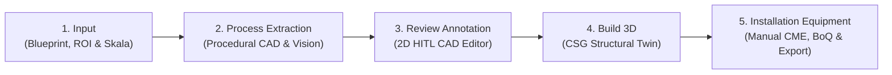

# Sitestry.AI — Application & Engineering Workflow (`WORKFLOW.md`)

This document defines both the **5-Stage Segmented User Workflow** inside the Sitestry.AI application and the **Engineering & Agent Handover Workflow** for contributors and coding agents.

---

## Part 1: 5-Stage Segmented Application Workflow

Sitestry.AI enforces a strict, uncluttered 5-stage architectural pipeline (`Input -> Process Extraction -> Review Annotation -> Build 3D -> Installation Equipment`). Each stage has its own dedicated sidebar panel (`#stagePanel1` .. `#stagePanel5`) and viewport mode controlled via `body[data-stage="1".."5"]`.

### Stage 1: Input (`data-stage="1"`)
- **Goal**: Load the 2D source floorplan, select the target PDF page (e.g., Page 4 for Gatsu, Page 13 for Ancol), isolate the floorplan geometry using the **Active ROI Crop Box (`[C]`)** to exclude the right-hand *Kop Surat* (Title Block), and calibrate `scale_px_per_meter` via **Auto-Calibrate Grid** or the **2-Point Metric Ruler (`[R]`)**.
- **Viewport State**: 2D Blueprint Canvas (`viewMode: "2d"`), structural overlays hidden so the user can clearly inspect the raw drawing and ROI boundaries.

### Stage 2: Process Extraction (`data-stage="2"`)
- **Goal**: Execute the deterministic 4-stage Procedural Vision & CAD Extraction engine (`POST /api/extract-layout`) and inspect the extracted structural topology overlaid on the original blueprint:
  1. **Wall & Small-Room Topology**: Extracts filled wall quads + parallel double-line walls (`1.3–5.5 px` spacing for small rooms, toilets, musholla, pantry, corridors, bridges), bridges wall gaps across doors/windows, and snaps L/T/X intersections (`TopologicalGraphBuilder`).
  2. **Door Leaf, Swing Arc & Door Tag Alignment**: Detects quarter-circle (`90°`) swing arcs and thin door leaves verified by nearby arc segments, pairing them into `single_door` (`D-xx`, `TD-xx`) or `double_door` (`DD-xx`) with exact **Door Tag** alignment.
  3. **Window Mullion & Glazing Detection**: Detects perimeter multi-line glazing symbols (`W-01..W-xx`).
  4. **Stair Step Cluster & Pillar Grid Recognition**: Detects periodic parallel stair treads ($\ge 5$ equidistant steps) and structural H-Beam / X-cross grid columns.
- **Note**: Equipment (`equipments: []`) and cable trays (`cable_trays: []`) are intentionally kept empty during structural extraction so the structural layout remains 100% clean.

### Stage 3: Review Annotation (`data-stage="3"`)
- **Goal**: Human-in-the-Loop (HITL) 2D CAD verification and manual refinement before 3D extrusion.
- **Capabilities**:
  - Drag **Topological Nodes (`[V]`)** with `0°/90°` Ortho-Snap to adjust wall corners.
  - Drag **Doors & Windows** directly along their host wall segment to fine-tune `offset_ratio`.
  - Draw new chained walls (`[W]`), double-click any wall to split it into two segments, or attach `Single Door [D]`, `Double Door [B]`, `Window [N]`, `Pillar [P]`, `Stair [S]`, and `Room Zone [Z]`.
  - Edit **Door Tag** (`DD-01`, `D-02`, `TD-01`), **Swing Direction** (`in-left`, `in-right`, `out-left`, `out-right`), wall material (`solid`, `cage_mesh`, `glass`), and dimensions in the Right Property Inspector.

### Stage 4: Build 3D (`data-stage="4"`)
- **Goal**: Procedurally extrude the verified 2D structural graph into an interactive 3D WebGL Digital Twin (`Viewer3DEngine`).
- **3D CSG & Architectural Geometry**:
  - Real boolean subtraction (`three-bvh-csg`) cuts door openings (`0.0m` to `2.15m`) and elevated window openings (`0.95m` sill to `2.20m` lintel, preserving bottom sill and top lintel walls).
  - Generates 3D door frames, semi-open swinging door leaves, mullioned glass windows, stepped 3D staircases with dual safety handrails, steel H-Beam columns, and 60x60cm Raised Floor Plenums.

### Stage 5: Installation Equipment (`data-stage="5"`)
- **Goal**: Manual installation of Telecommunication CME / Data Center MEP hardware inside the verified 3D building structure (`Split 2D | 3D Sync` view).
- **Capabilities**:
  - Select from the CME Catalog (`42U Server Rack`, `UPS 250kVA Frame`, `Lithium Battery Bank`, `DC Rectifier`, `ACPDB/SDP Panel`, `PAC Precision Cooling`) and click on the floorplan to place, drag to reposition, or rotate `90°`.
  - Draw 3D overhead or underfloor **Cable Ladders (`[T]`)**.
  - Review live Bill of Quantities (BoQ) and export standardized `.JSON` schema or binary `.GLB` 3D model.

---

## Part 2: Engineering & Agent Development Workflow

Every engineering task or feature phase must follow this sequence:

1. **Context & State Check**:
   - Read `AGENTS.md`, `CHANGELOG.md`, `todo.md`, and `GLOSSARY.md`. Do not re-read files already in context.
2. **Grill & Specification (`grill-me` / `grill-with-docs` / `Superpowers`)**:
   - Before writing code for underspecified or architectural changes, stress-test requirements with the user via `grill-me` rounds.
   - Save any generated specification or implementation plan to `docs/superpowers/specs/` or `docs/superpowers/plans/` (never duplicate plans, and **never commit** plans to Git).
3. **Phase Task Tracking (`todo.md`)**:
   - Ensure all tasks in the previous `todo.md` phase are completed (`[x]`), then **overwrite** `todo.md` with the new phase's actionable checklist.
4. **Atomic Implementation & Git Hygiene**:
   - Implement changes cleanly following `DESIGN.md` (for UI) and `GLOSSARY.md` (for domain models).
   - Update `.gitignore` whenever new untracked artifacts/files should be excluded.
   - Commit every functional change atomically **without any AI attribution** (repo owner only).
5. **Verification & Documentation Sync**:
   - Verify backend extraction (`cad_parser.py`, `vectorizer.py`, `main.py`) and frontend 2D/3D rendering (`store.js`, `canvas2d.js`, `viewer3d.js`, `app.js`).
   - Update `CHANGELOG.md`, `todo.md`, and core docs (`WORKFLOW.md`, `AGENTS.md`, `GLOSSARY.md`) whenever key features or workflows change.
